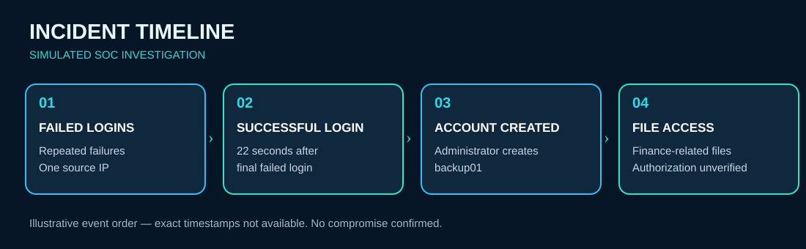
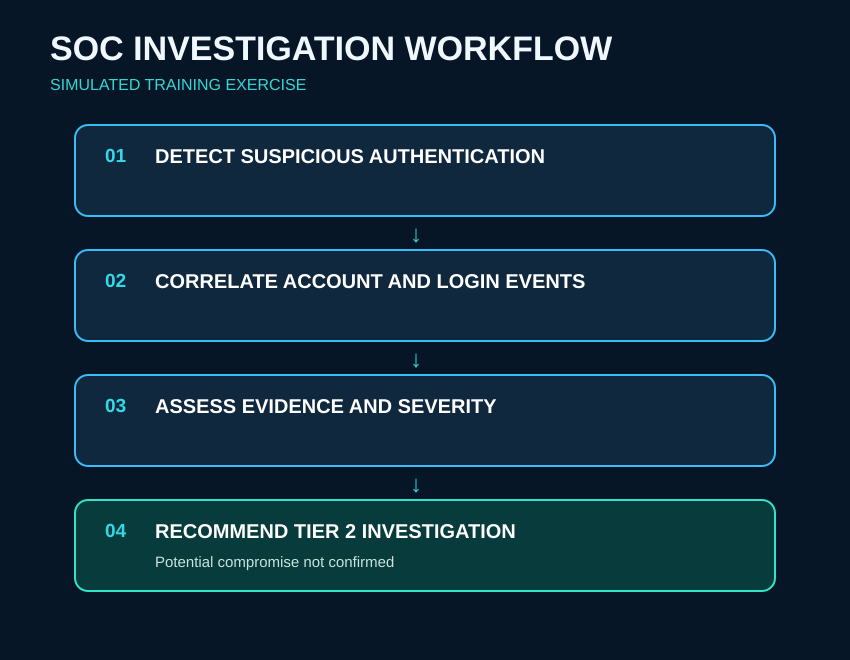

# SOC Investigation 001 — Suspicious Authentication Activity

> **Simulated SOC training exercise.** This project documents an analytical exercise, not a confirmed security breach or a validated live Splunk investigation.

## Project Overview

This project documents a simulated Security Operations Center (SOC) investigation involving failed logins, a subsequent successful login, creation of a new account, and access to finance-related files.

| Field | Details |
| --- | --- |
| Investigation type | Simulated SOC training exercise |
| Focus | Authentication monitoring, account activity, incident triage |
| Tools and concepts | Splunk investigation concepts, SIEM analysis, authentication logs |
| Status | Simulated investigation documented; hands-on Splunk validation pending |

## Incident Timeline

The scenario described multiple failed login attempts from the same source IP, followed by a successful login approximately **22 seconds after the final failed attempt**. Subsequent activity included an administrator creating `backup01` and finance-related file access. The exact timestamps and causal relationships between these events have not been independently verified.

## SOC Investigation Workflow

## Key Observations

1. Multiple failed authentication attempts preceded a successful login.
2. The successful login occurred approximately 22 seconds after the last failure.
3. An administrator account was associated with creating `backup01`.
4. Finance-related file access was described after the authentication activity.

## Investigation Assessment

The authentication pattern could be consistent with password guessing or a brute-force attempt, but benign explanations and other causes remain possible. The subsequent account creation and file access warrant investigation; the available scenario evidence does **not** establish that these actions were unauthorized, related to the failed logins, or malicious.

## Severity Assessment

**Provisional severity: High (training judgment, subject to validation).**

The combination of authentication anomalies, account creation, and potentially sensitive file access supports prioritizing investigation in this simulated scenario. A real incident's severity would depend on confirmed privileges, business impact, asset sensitivity, authorization, and corroborating evidence.

## Recommended Investigation Steps

1. Review the administrator's usual login history and identify deviations.
2. Examine source IP, source device, and geographic context.
3. Check MFA records and authentication outcomes.
4. Confirm whether the creation of `backup01` was authorized.
5. Review the new account's privileges and subsequent activity.
6. Identify the finance-related files accessed and verify authorization.
7. Correlate authentication, account-management, and file-access events by timestamp and identity.
8. Escalate to Tier 2 if suspicious activity remains unexplained.

## Outcome

The simulated incident was assessed as suspicious and recommended for further investigation. **No confirmed compromise, malicious insider activity, or unauthorized file access was established.**

## Skills Demonstrated

- Authentication anomaly recognition and event interpretation
- SOC triage and provisional severity assessment
- Evidence-based analysis and documentation
- Escalation recommendations and investigative planning

## Limitations and Next Steps

This README documents a **simulated tabletop-style investigation**. It does not yet contain original log exports, SPL queries, actual Splunk search results, or screenshots. Future work will reproduce relevant activity with sample logs, validate SPL searches, capture sanitized results, and refine the timeline and severity based on observed evidence.

The diagrams in `images/` are **illustrative graphics**, not screenshots of actual Splunk results.

---
*All events are part of a cybersecurity training exercise and do not represent an actual security breach.*
